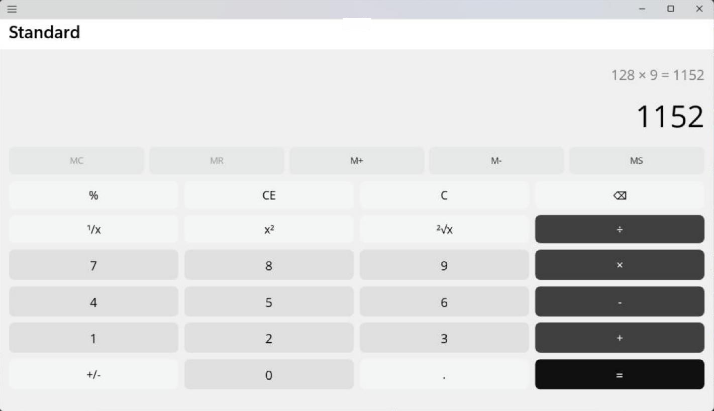
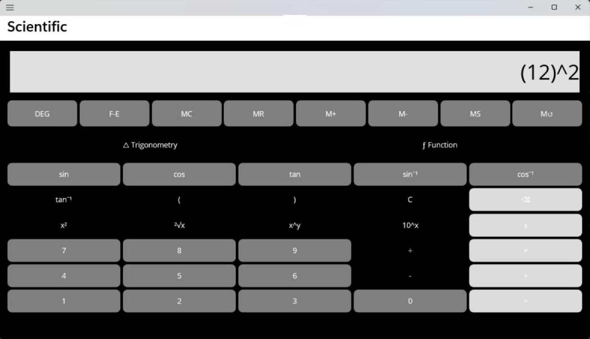
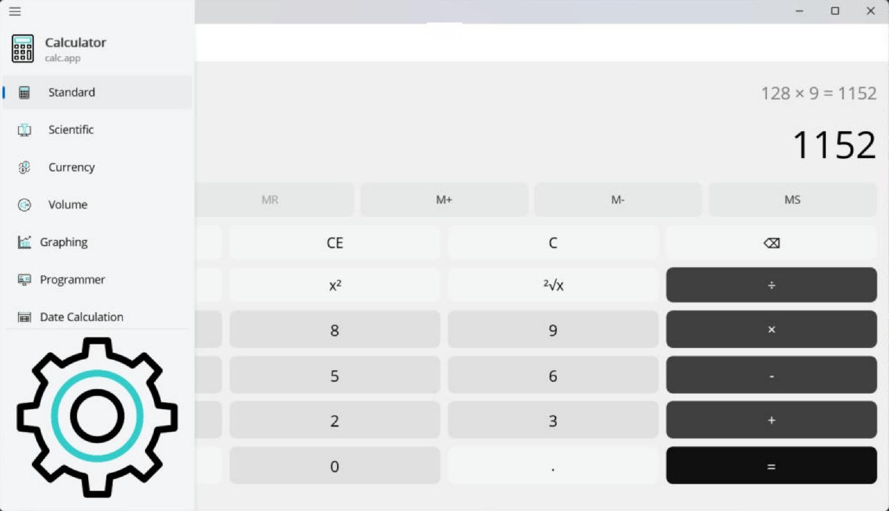

# Calculator

A cross-platform calculator built with .NET MAUI, modeled on a desktop calculator app, with standard and scientific modes.


## Screenshots

| Standard | Scientific |
|---|---|
|  |  |



## Features

**Standard mode**
- Basic arithmetic, percent, square, square root, reciprocal and sign change
- Memory functions: MC, MR, M+, M−, MS

**Scientific mode**
- Trigonometry: sin, cos, tan and their inverses, in degrees
- Powers and logs: x², xʸ, 10ˣ, log, ln, exp
- Factorial, absolute value, π and F-E notation

**Navigation**
- Flyout menu with placeholders for Graphing, Programmer, Date and converter modes (currency, volume)

## Run

Requirements: .NET 10 SDK with the MAUI workload (included in Visual Studio's ".NET Multi-platform App UI development" workload).

```bash
dotnet workload install maui
dotnet build -t:Run -f net10.0-windows10.0.19041.0   # Windows
dotnet build -t:Run -f net10.0-android               # Android
```

On Windows, turn on Developer Mode (Settings → System → For developers) to run the app from Visual Studio.

---

Made by [Mariam Mahmoud](https://github.com/mar7233)
